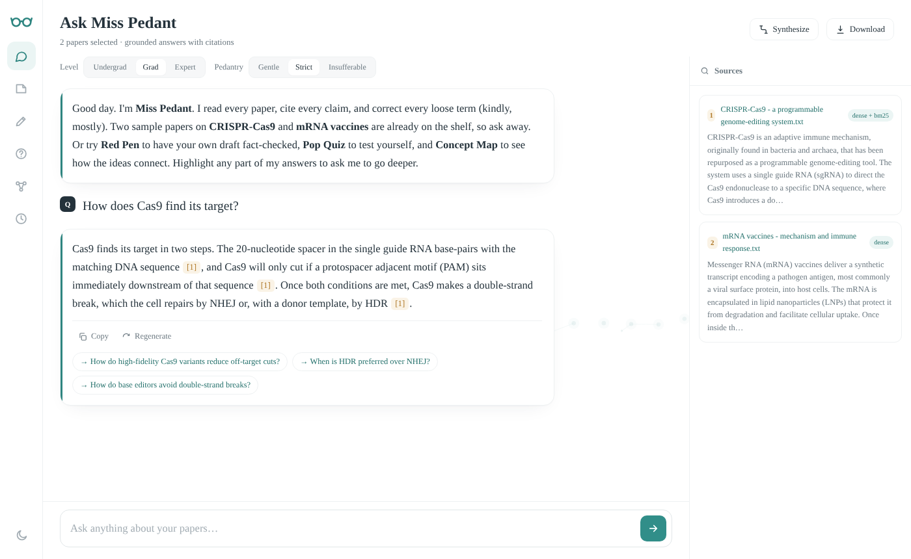

# Miss Pedant

A research assistant that reads your papers, answers with citations you can trace, and fact-checks your own writing. Built for scientists, researchers and students.



## Features

- **Ask** questions across up to 10 uploaded papers (PDF, TXT, Markdown). Every claim is cited back to the passage it came from.
- **Red Pen** checks a draft sentence by sentence: supported, contradicted, or not in your papers.
- **Pop Quiz** writes and grades five questions from your papers.
- **Concept Map** draws an interactive graph of how the ideas across your papers connect.
- **Reviewer #2** gives any paper a sharp but useful peer review.
- **Synthesize**, reading-level and tone controls, chat history, and export to `.md`, `.txt` or `.docx`.

## How it works

Uploads are split into sentence-aware chunks and indexed with BGE embeddings in Chroma. Each question runs dense search and BM25 in parallel, merges them with reciprocal rank fusion, and reranks the shortlist with a cross-encoder. The model answers only from those passages. It runs locally on Apple Silicon through `mlx-lm`, or through the Claude or OpenAI API.

## Quick start

```bash
git clone https://github.com/<your-username>/miss-pedant.git
cd miss-pedant
python3.11 -m venv .venv && source .venv/bin/activate
pip install -r requirements.txt
cp .env.example .env
./run.sh
```

Open http://127.0.0.1:8000. The first launch downloads about 5 GB of models. Two sample papers are indexed automatically so you can start asking right away.

To use the Claude API instead of a local model, set `LLM_PROVIDER=anthropic` and `ANTHROPIC_API_KEY` in `.env`.

## Documentation

The full [user and developer manual](docs/MANUAL.md) covers setup, every feature, configuration, the API, customization and troubleshooting.

## Tests

```bash
pip install -r requirements-dev.txt
pytest
```

The suite uses stand-in models, so it runs in seconds without downloads. It also runs on every push through GitHub Actions.

## License

MIT
